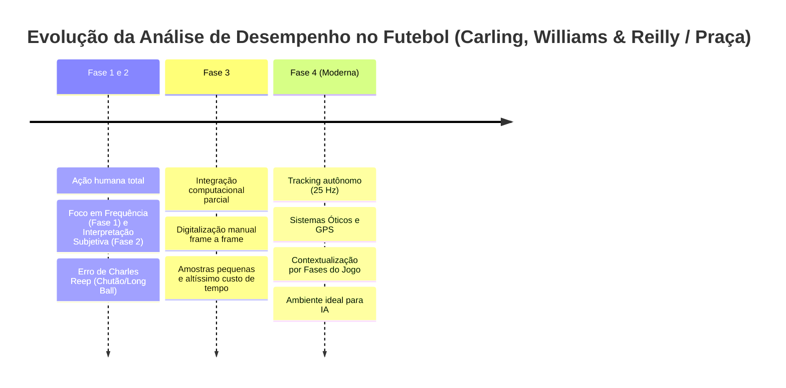

# CÉREBRO — Módulo Avançado: Análise Tática Individual e Coletiva
## Dr. Gibson Moreira Praça (CECA / UFMG • FIFA Coach Educator • CBF Academy)

**Data de Consolidação:** Outubro de 2026  
**Fonte Original:** Slides Oficiais de Aula (94 slides) — *Análise individual e Coletiva*  
**Instituição:** Centro de Estudos em Cognição e Ação (CECA) / EEFFTO - Universidade Federal de Minas Gerais (UFMG)  
**Status do Cérebro:** 100% Alimentado, Modelado Matematicamente e Pronto para Inferência

---

## 🧭 Visão Sistêmica e Epistemologia da Análise Posicional

A Ciência de Dados no futebol contemporâneo não se resume à coleta passiva ou à agregação fria de frequências. Conforme preconizado pelo Dr. Gibson Moreira Praça, o ciclo metodológico de elite obedece à cadeia de valor:

$$\text{Obtenção de Dados} \longrightarrow \text{Tratamento dos Dados} \longrightarrow \text{Interpretação Contextual} \longrightarrow \text{Geração de Insights Acionáveis}$$

### As 4 Fases da Evolução da Análise de Desempenho



1. **Fases 1 e 2 (Subjetividade e o Erro Histórico de Charles Reep):**
   - Dependência total do olho humano e viés partidário do observador.
   - *O Erro de Charles Reep:* Observou-se que a maioria dos gols saía de sequências com menos de 4 passes. A conclusão espúria foi de que os times deveriam jogar de forma direta ("chutão inglês"). A falácia: sequências curtas são infinitamente mais frequentes no jogo e a recuperação próxima à área adversária é a real causa do gol. **Analisar é muito mais do que obter dados; exige discernir causalidade de correlação.**
2. **Fase 3 (Sistemas Computacionais Rudimentares):**
   - Digitalização semi-manual de coordenadas clicando em tela. Tempo proibitivo para o dia a dia de clubes.
3. **Fase 4 (Era dos Dados de Posição & IA):**
   - Coleta contínua de alta frequência ($10\text{ a }25\text{ Hz}$).
   - Foco na **contextualização dinâmica**.
   - **O Axioma Fundamental das Fases:**
     > *"Existe um jogo na fase ofensiva e outro jogo completamente diferente na fase defensiva. Em nenhum deles a dinâmica se parece com a dinâmica média."*
   - Medir a média geral de um jogo mascara a realidade tática: um time que ataca em 3-2-5 e defende em 5-4-1 parecerá estatisticamente um 4-3-3 inexistente no papel.

---

## 📡 Natureza dos Dados: Eventos vs. Posição (Tracking Data)

| Dimensão | Dados de Evento (*Event-based*) | Dados de Posição (*Tracking Data*) |
| :--- | :--- | :--- |
| **O que registra** | O que aconteceu **com a bola** (passes, desarmes, chutes, faltas). | Onde cada jogador esteve **o tempo todo**, com e sem bola. |
| **Limitação clássica** | O mapa de calor de um cobrador de faltas aponta manchas vermelhas nos escanteios, distorcendo sua real área de atuação. | Mapeia ocupação espacial contínua, compactação, cobertura e linhas de passe sem bola. |
| **Sistemas de Coleta** | Wyscout, Opta, StatsBomb (Anotação manual/mista). | **Ótico/LPS** (TRACAB, ChyronHego a 25 Hz) ou **GPS/GNSS** (Catapult, GPSports, STATSports a 10–25 Hz). |
| **Confiabilidade Científica** | Baixa a moderada (alta variabilidade inter-observador). | **Excelente confiabilidade intra e intersessão** comprovada cientificamente (Praça et al., 2022). |

---

## 📐 Matriz Matemática de Variáveis Táticas Coletivas

O campo é modelado como um plano cartesiano 2D:
- **Eixo $X$ (Profundidade):** $0\text{ m a }105\text{ m}$ (do gol a defender ao gol a atacar).
- **Eixo $Y$ (Largura/Amplitude):** $0\text{ m a }68\text{ m}$ (da lateral esquerda à lateral direita).

```
                      Gol Adversário (X = 105 m)
        ┌─────────────────────────────────────────────────┐
        │                 Último Terço                    │ (X > 70 m)
        │                  Ofensivo                       │
        ├─────────────────────────────────────────────────┤
        │                                                 │
        │                  Meio-Campo                     │
        │                  (Transição)                    │
        ├─────────────────────────────────────────────────┤ (X = 52.5 m)
        │                                                 │
        │                 Campo Defensivo                 │
        │                                                 │
        ├─────────────────────────────────────────────────┤
        │                 Último Terço                    │ (X < 35 m)
        │                  Defensivo                      │
        └─────────────────────────────────────────────────┘
                      Próprio Gol (X = 0 m)
          Y = 0 m (Esquerda)            Y = 68 m (Direita)
```

### 1. Distância Euclidiana ($d$)
A base trigonométrica para qualquer distância em plano 2D:
$$d = \sqrt{(x_2 - x_1)^2 + (y_2 - y_1)^2}$$

### 2. Profundidade da Equipe (*Team Length* - $Prof$)
Distância em módulo no eixo $X$ entre o jogador mais adiantado e o jogador mais recuado da equipe:
$$Prof = |A_x - B_x|$$
*   **Aplicação Prática:** Aumenta consideravelmente em situações de marcação em bloco alto e em equipes com estilo de jogo direto/vertical.

### 3. Largura da Equipe (*Team Width* - $Larg$)
Distância em módulo no eixo $Y$ entre o jogador mais aberto à esquerda e o mais aberto à direita:
$$Larg = |A_y - B_y|$$
*   **Aplicação Prática:** Aumenta em momentos de ataque posicional (amplitude máxima para alargar o bloco adversário) e em defesas em bloco baixo que protegem toda a extensão da área.

### 4. Altura da Última Linha Defensiva ($ALT_{linha}$)
Distância em metros entre o último defensor de linha e o próprio gol ($P_0$):
$$ALT_{linha} = |P_x - P_0|$$
*   **Regra de Ouro Tática:** Para marcar em bloco alto, é imperativo ter um valor elevado de $ALT_{linha}$ (linha de zaga adiantada perto do círculo central). Caso a linha de frente suba e a última linha permaneça colada na própria área, ocorre **descompactação catastrófica** e perda do controle espacial.

### 5. Altura do Centroide da Equipe ($ALT_{cent}$)
Distância entre a posição média de todos os jogadores de linha e a linha do próprio gol:
$$ALT_{cent} = |\mu_x - P_0| \quad \text{onde} \quad \mu_x = \frac{1}{N}\sum_{i=1}^{N} P_{xi}$$
*   **Aplicação Prática:** É a métrica mais confiável de **Domínio Territorial**. Valores elevados indicam que o time opera majoritariamente empurrando as linhas adversárias.

### 6. Razão Profundidade/Largura (*Length-per-Width Ratio* - $LPW_{ratio}$)
Proporção geométrica entre a profundidade e a largura médias da equipe:
$$LPW_{ratio} = \frac{Prof_{méd}}{Larg_{méd}}$$
*   **$LPW_{ratio} > 1.0$:** Equipe esticada longitudinalmente e estreita lateralmente. Assinatura matemática de **Jogo Direto** (verticalidade, contra-ataques velozes, ligação direta).
*   **$LPW_{ratio} < 1.0$:** Equipe com grande amplitude lateral e profundidade controlada. Assinatura matemática de **Jogo Apoiado / Posicional** (construção paciente, circulação sustentada de posse, passes curtos).

### 7. Índice de Alongamento (*Stretching Index* - $IA$)
Média da distância euclidiana de cada jogador de linha até o centroide ($C_x, C_y$) da equipe:
$$D_i = \sqrt{(J_{ix} - C_x)^2 + (J_{iy} - C_y)^2}$$
$$IA = \frac{1}{N}\sum_{i=1}^{N} D_i$$
*   **Significado Físico-Tático:** É a medida matemática mais pura e objetiva de **COMPACTAÇÃO COLETIVA**.
*   **Interpretação:** Quanto menor o valor de $IA$, mais compacta, curta e coesa está a equipe naquele intervalo de tempo.

### 8. Distância Entre Setores ($DS$)
Distância euclidiana entre os centroides médios dos setores da equipe (Defesa, Meio-Campo e Ataque):
$$DS_{\text{Def-Mei}} = \sqrt{(\mu_{x\text{Def}} - \mu_{x\text{Mei}})^2 + (\mu_{y\text{Def}} - \mu_{y\text{Mei}})^2}$$
*   **Diagnóstico de Ruptura:** Permite identificar com exatidão cirúrgica **onde** a equipe está partida. Se $DS_{\text{Mei-Ata}} = 10\text{ m}$ mas $DS_{\text{Def-Mei}} = 24\text{ m}$, o diagnóstico é claro: os meio-campistas avançaram na pressão, mas a zaga "afundou", gerando o temido "espaço entrelinhas" para o rival explorar.

### 9. Relação Ataque / Último Terço ($ATA\text{-}UTO$)
Razão entre o tempo em que o centroide da equipe esteve no último terço ofensivo ($T_{uto}$, $X > 70\text{ m}$) e o tempo no campo de ataque ($T_{ata}$, $X > 52,5\text{ m}$):
$$ATA\text{-}UTO = \frac{T_{uto}}{T_{ata}}$$
*   **Interpretação:** Valores próximos a $1.0$ indicam que quando a equipe cruza o meio-campo, ela não apenas circula estéril, mas fixa seu centroide dentro do terço final, exercendo **pressão sufocante de gol**.

### 10. Relação Defesa / Último Terço ($DEF\text{-}UTD$)
Razão entre o tempo do centroide no último terço defensivo ($T_{utd}$, $X < 35\text{ m}$) e o tempo no campo defensivo ($T_{def}$, $X < 52,5\text{ m}$):
$$DEF\text{-}UTD = \frac{T_{utd}}{T_{def}}$$
*   **Interpretação:** Quanto mais distante de $1.0$ for este índice, melhor para a equipe defensora. Se o valor for próximo de $1.0$, o time está sofrendo "amasso", colado à própria pequena área, quase sempre vulnerável a faltas laterais, cruzamentos e escanteios.

### 11. Coordenação Interpessoal: Padrões *In-Phase* vs. *Anti-Phase* (Vector Coding)
Mapeia a sincronia dinâmica do vetor de deslocamento angular entre pares de atletas ao longo do tempo:
*   **Padrão Em Fase (*In-Phase*):** Percentual do tempo em que pares (ex: Zagueiro Central e Quarto Zagueiro) se deslocam rigorosamente na mesma direção e no mesmo sentido. Essencial para subir a linha de impedimento e bascular em sincronia. Times com alto índice *In-Phase* apresentam probabilidade sistematicamente maior de vitória.
*   **Padrão Anti-Fase (*Anti-Phase*):** Deslocamento em direções ou sentidos opostos. É funcional entre laterais opostos (um desce enquanto o outro sobe para equilibrar), mas quando generalizado no setor de meio ou zaga, evidencia **anarquia posicional e falta de treinamento conjunto**.

---

## 🎯 Matriz Matemática de Variáveis Táticas Individuais

### 1. Índice de Exploração Espacial ($IEE$)
Mede a distância euclidiana média entre a posição instantânea do jogador a cada momento ($T_i$) e sua posição média global ($\mu_x, \mu_y$) na partida:
$$IEE_i = \sqrt{(P_{xi} - \mu_x)^2 + (P_{yi} - \mu_y)^2}$$
$$IEE = \frac{1}{K}\sum_{i=1}^{K} IEE_i$$
*   **Leitura de Perfil:**
    *   **Baixo $IEE$:** Atleta altamente posicional, disciplinado, que guarda setor (ex: zagueiro clássico de área, volante 5 fixo).
    *   **Alto $IEE$:** Atleta móvel, dinâmico, de alta intensidade e cobertura de campo (ex: volante *box-to-box*, atacante de movimentação, ponta que flutua entre corredores).
    *   **Aplicação Pedagógica na Base:** Treinos de categorias menores devem priorizar tarefas que induzam alto $IEE$ para desenvolver repertório motor e tomada de decisão em múltiplos cenários espaciais.

### 2. Tempo no Campo de Ataque ($TCA$) e de Defesa ($TCD$)
Percentual de frames em que o jogador esteve além ou aquém da linha de $52,5\text{ m}$:
$$TCA = \frac{\sum (P_{xi} > 52,5)}{N_{\text{total}}} \times 100\% \qquad TCD = \frac{\sum (P_{xi} \le 52,5)}{N_{\text{total}}} \times 100\%$$
*   *Insight de Scout:* Se um zagueiro apresenta $TCA > 45\%$, sua equipe exerce domínio territorial asfixiante, exigindo desse defensor velocidade de recuperação e duelo em campo aberto.

### 3. Tempo no Último Terço Ofensivo ($TUO$) e Defensivo ($TUD$)
Percentual de frames em que as coordenadas situam-se nos terços extremos ($X > 70\text{ m}$ ou $X < 35\text{ m}$).
*   *Insight de Scout:* A presença consistente de meio-campistas (camisas 8 e 10) no $TUO$ ($> 25\%$) é a assinatura de equipes com volume de criação letal na área.

### 4. Assimetria Longitudinal / Lados do Campo
Separação do eixo $Y$ pela linha média de $34,0\text{ m}$:
*   Identifica inversões táticas e "assimetrias intencionais". Revela se um ponta nominalmente escalado na direita atuou $75\%$ do tempo no corredor esquerdo (sobrecarga tática em fase de construção).

---

## 🤖 Evidências Científicas: Modelagem com Machine Learning & SHAP

O Dr. Gibson Moreira Praça testou múltiplos algoritmos preditivos (Random Forest, SVM, Redes Neurais Artificiais) usando o software *Orange* e explicabilidade matemática via **SHAP (SHapley Additive exPlanations)** para descobrir quais variáveis discriminam a vitória da derrota e quais separam o futebol de Clubes do futebol de Seleções:

### 1. As Variáveis Mais Preditivas de Vitória (Ranking SHAP de Elite)
Entre mais de 50 variáveis espaciais e de eventos analisadas:
1. **Passes certos totais** $\uparrow$ (aumentam drasticamente a chance de vitória)
2. **Passes longos certos** $\uparrow$ (capacidade de quebra de pressão e virada de jogo)
3. **Volume de Finalizações** $\uparrow$
4. **Pressão no adversário & Pressão pós-perda imediata** $\uparrow$
5. **Altura do time na construção ($ALT_{cent}$)** $\uparrow$ (construir alto correlaciona-se diretamente com o sucesso)
6. **Avanço progressivo da bola no campo** $\uparrow$
7. **Largura excessiva no último terço** $\downarrow$ (**REDUZ a chance de vitória!** Equipes vencedoras alargam o campo na construção intermediária, mas afunilam e concentram jogadores próximos à área no momento da finalização para garantir rebotes e finalizações centrais de alto xG).
8. **Transição defensiva desorganizada** $\downarrow$ (maior preditor isolado de derrota).

### 2. O Que Separa o Jogo de Clubes do Jogo de Seleções?
*   **Clubes Vencem por Gestão Sistêmica da Posse:** Apresentam índices significativamente maiores de progressão de bola, recepções por passe, recepções no último terço e manutenção de posse sustentada. Reflexo de meses de treino tático coletivo.
*   **Seleções Vencem por Intensidade e Transição:** Apresentam índices muito maiores de pressão agressiva no adversário, chegadas rápidas e verticais no último terço e profundidade terminal. Como não há tempo hábil de entrosamento em janelas FIFA, prevalecem a compactação física e as transições fulminantes.

### 3. A Dinâmica da Fadiga e o Efeito Casa vs. Fora
*   **Fadiga no Segundo Tempo:** A exploração espacial ($IEE$) sofre queda estatisticamente significante no segundo tempo. A equipe até consegue manter o "desenho" geométrico médio, mas os jogadores ficam mais estáticos, tornando as jogadas mais lentas e previsíveis.
*   **Fator Local:** Jogar fora de casa aumenta o $IEE$ (os atletas são forçados a correr mais reativamente cobrindo espaços) e reduz a ocupação em largura. O impacto psicológico e tático é ainda mais agudo em atletas jovens de categorias de base.
*   **Estudo Bundesliga 22-23:** O padrão das equipes campeãs foi comprovado pela **velocidade de chegada ao terço final** somada ao **controle numérico e territorial imediato do espaço ao redor da bola**.

---

## 📢 Diretrizes Executivas de Comunicação com a Comissão Técnica

Para que o trabalho do analista gere impacto real no vestiário e na prancheta do treinador, o Dr. Gibson Moreira Praça estabelece regras pétreas:

1. **Abolição de Frações Decimais de Tempo:**  
   Treinadores operam sob alta carga cognitiva e não entendem números como "$18,34\text{ minutos}$" (que não são 18 minutos e 34 segundos). Converta sempre para **Percentuais (%)**:  
   *Diga: "Nosso camisa 10 passou 72% do tempo pisando no campo ofensivo e 38% no último terço."*
2. **Preferência por Representação Visual Inteligente:**  
   Substitua planilhas cinzentas por retângulos de ocupação posicional (padrão FIFA), polígonos convexos de compactação (*Convex Hull*) e mapas vetoriais de centroide.
3. **Escalas Semafóricas com Interpretação Acoplada:**  
   O número puro não é análise; a interpretação contextual faz parte do dado. Utilize escalas de calor (Verde/Neutro/Vermelho) calibradas em relação aos percentis da própria competição.
4. **O Princípio de Johan Cruyff:**  
   > *"Jogar futebol é muito simples, mas jogar futebol simples é a coisa mais difícil que há."*  
   O mesmo se aplica à Ciência de Dados: coletar milhões de coordenadas é elementar; destilar isso em 3 conclusões simples, elegantes e cirúrgicas que ganhem o jogo no domingo é a arte do Cientista de Elite.

---

## 📝 Banco de Desafios Práticos do Mestre Gibson Moreira Praça (Gabarito Metodológico)

O material inclui 6 desafios práticos que balizam a formação de analistas de desempenho:

*   **Desafio 1 (Posição Média por Fases de Jogo):**  
    Calcular a posição média de cada jogador no plano cartesiano separadamente para Organização Ofensiva, Organização Defensiva, Transição Ofensiva e Transição Defensiva.
*   **Desafio 2 (Domínio Territorial Coletivo):**  
    Computar e plotar visualmente $ALT_{cent}$, $ATA\text{-}UTO$ e $DEF\text{-}UTD$, identificando se o time impôs amasso ou posse inócua.
*   **Desafio 3 (Compactação Coletiva Comparada):**  
    Avaliar se a equipe esteve mais compacta em Organização Defensiva do que em Organização Ofensiva cruzando o Índice de Alongamento ($IA$) com a Distância Entre Setores ($DS$).
*   **Desafio 4 (Dinâmica Individual de Exploração):**  
    Identificar atletas estáticos vs. dinâmicos via $IEE$ e contrastar com o tempo de permanência em ataque e defesa ($TCA/TCD$).
*   **Desafio 5 (Equilíbrio dos Corredores e Assimetria):**  
    Verificar se zagueiros, volantes e centroavante balancearam as ações entre a ala esquerda ($Y < 34$) e direita ($Y > 34$).
*   **Desafio 6 (Informe Técnico Anual da Base):**  
    Estruturar relatório executivo para categorias Sub-14, Sub-15, Sub-17 e Sub-20 cruzando minutagem, efeito do mando de campo (casa/fora) e resultado final da partida.

---

**Metadados do Cérebro:**
- **Tags de Indexação:** `#analise-posicional` `#tracking-data` `#gibson-moreira-praca` `#ufmg` `#ceca` `#cbf-academy` `#stretching-index` `#lpw-ratio` `#coordenacao-in-phase` `#ciencia-de-dados-futebol`
- **Versão:** 3.0 (Integração Total Roberto Torrecilhas + Gibson Moreira Praça)
